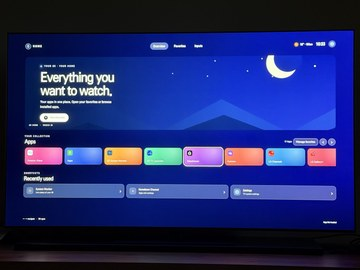
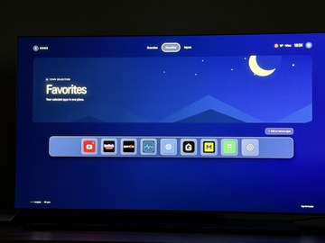
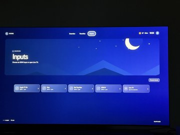

# G5 TV Launcher 0.2.28

[English](README.md) · [Deutsch](README.de.md)

A standalone homebrew launcher for a rooted LG G5 with webOS 25. It provides a TV-oriented interface with a customizable favorites dock and input shortcuts.

## Screenshots

Click an image to view it full size.

<a href="screenshots/overview.jpg"></a>
<a href="screenshots/favorites.jpg"></a>
<a href="screenshots/inputs.jpg"></a>

## Features

- Browse and launch installed apps from Overview; HDMI inputs and Live TV have their own Inputs page.
- Add, remove and reorder favorites in the glass-style dock. Show app icons with or without names and choose from three icon sizes when names are hidden.
- Navigate using the Magic Remote directional controls, pointer and wheel.
- Open HDMI 1–4 and Live TV. HDMI names can be read from the TV's launch points or customized.
- Choose from five illustrated scenes, shown in the banner on Overview, Favorites and Inputs.
- Show or hide the clock and weather independently, and choose a weather location.
- Select Overview, Favorites or Inputs as the start page, including when reopening the launcher.
- Switch the interface between English and German; English is the default.
- Optionally assign the Home button to this launcher using Magic Mapper 1.1.2, and restore the previous mapping. [Requirements and details](#optional-home-button-mapping).
- Save and restore launcher settings, favorites and custom input labels as a JSON backup on the TV.

## Downloads and source

- [Download IPK 0.2.28](g5-tv-launcher_0.2.28_all.ipk)
- [Download source ZIP](g5-tv-launcher-source_0.2.28.zip)
- [Complete app source](app/)
- [Development notes](DEVELOPMENT.md)
- [Changelog](CHANGELOG.md)

## Installation

A rooted TV and a working Homebrew Channel service are required. Transfer the IPK to `/tmp` using SFTP, then install it via SSH:

```sh
luna-send-pub -i 'luna://com.webos.appInstallService/dev/install' '{"id":"com.ares.defaultName","ipkUrl":"/tmp/g5-tv-launcher_0.2.28_all.ipk","subscribe":true}'
```

Glasshouse's IPK upload can also be used. The app ID is `org.schrotty74.g5launcher`.

## Notes

The launcher is an ordinary app. Installing it does not automatically replace LG Home or configure the Home button or autostart. It uses the Homebrew service to read launch points and local app icons; unavailable icons fall back to a letter. Weather uses Open-Meteo and requires an internet connection. Backups are stored at `/media/developer/g5-tv-launcher/backup.json` on the TV and can be copied via SFTP. Saving again replaces the previous backup. The Live TV shortcut and exact appearance should be checked on the target TV.

## Build from source on macOS

Install Python 3, open Terminal in this app directory, and run:

```sh
python3 build.py
```

The script writes `dist/g5-tv-launcher_0.2.28_all.ipk`. Use `python3 build.py --output /path/to/output` to choose another output directory. It uses only Python's standard library; no absolute path to the developer's computer is needed.

## Optional Home button mapping

The optional Home button mapping requires [Magic Mapper for webOS 1.1.2](https://github.com/afonsojramos/magic-mapper-webos/releases/tag/v1.1.2) to be installed, active and configured to start on the TV. This launcher integration checks for version 1.1.2. See the [Magic Mapper project and Homebrew installation instructions](https://github.com/afonsojramos/magic-mapper-webos#installing-from-homebrew-channel).

In the launcher's Settings, explicitly assign Home to this launcher. You do not need to configure the Home button manually in Magic Mapper first; the launcher applies the mapping through Magic Mapper. The previous Home mapping is saved locally and can be restored from the same screen; other button mappings are retained. Restore the previous mapping before uninstalling the launcher. Glasshouse Home or other Home remappers may interfere. This option does not install Magic Mapper or change its startup hook.

The launch view can be set to Overview, Favorites or Inputs and also applies when the launcher is reopened. The selected illustrated scene is shown in the banner on all three pages.

## Language

English is the default. Change the language to English or German under Settings → Language. The selection is stored on the TV and included in settings backups.
