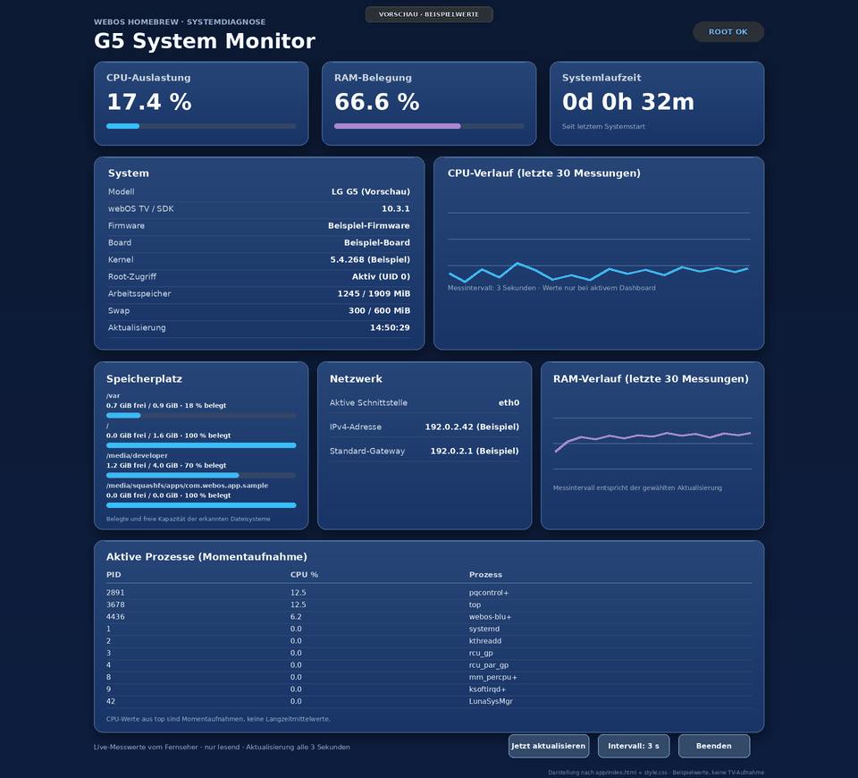

# G5 System Monitor 0.9.3

A homebrew dashboard for the LG G5 running webOS 25, with a dark layout designed for TV screens.

[English](README.md) | [Deutsch](README.de.md)



*Preview only: all displayed values are sample data, not captured from a TV.*

## Features

- CPU and RAM usage, with history charts for the last 30 readings
- Uptime, kernel, root status, model, firmware, SDK, and board information
- Filesystem free/used space with usage bars
- Active network interface, IPv4 address, and default gateway
- Snapshot of active processes and swap usage
- Refresh interval selectable between 3, 5, and 10 seconds
- Scrolling with the Magic Remote or mouse wheel; Back and Exit controls
- No temperature tile: no readable sensor value was found on the tested G5

## Files

- `app/` contains the complete app source, including its icon
- [Download the IPK](g5-system-monitor_0.9.3_all.ipk)
- [Download the source ZIP](g5-system-monitor-source-v0.9.3.zip)

## Installation

Transfer the IPK to the TV, for example to `/tmp`, then install it as root through the webOS installation service:

```sh
luna-send-pub -i 'luna://com.webos.appInstallService/dev/install' '{"id":"com.ares.defaultName","ipkUrl":"/tmp/g5-system-monitor_0.9.3_all.ipk","subscribe":true}'
```

The app ID is `org.schrotty74.g5systemmonitor`. For an update, install the package with the same app ID. Check that the path in the command matches the transferred file.

## Safety and limitations

The app reads system values through the existing Homebrew Luna service and local system files. It does not accept user-entered shell commands, run a background service, or change system partitions, firmware, root configuration, or autostart. The refresh interval is only kept for the current session.

## Development documentation

- [Development notes](DEVELOPMENT.md): architecture, data sources, checks, current UI observation, and constraints for future work.
- [Changelog](CHANGELOG.md): development history and user requirements by version.
